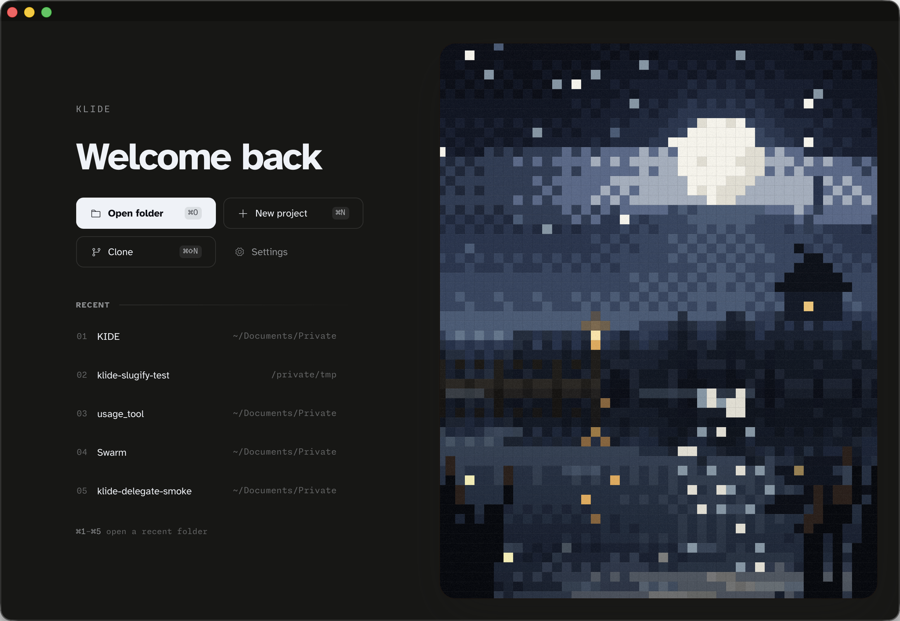
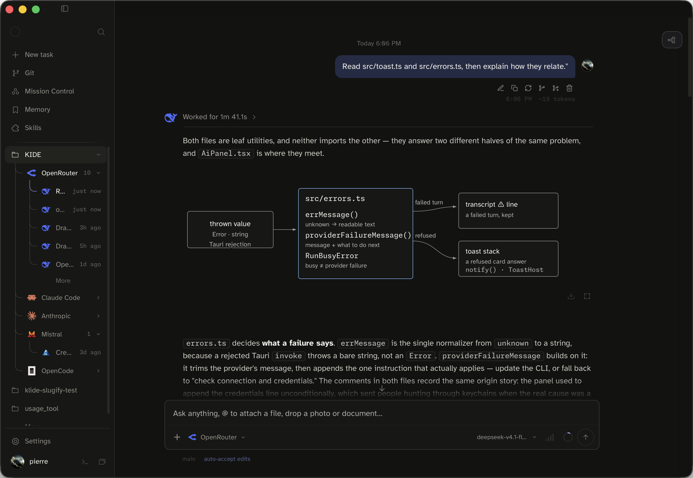
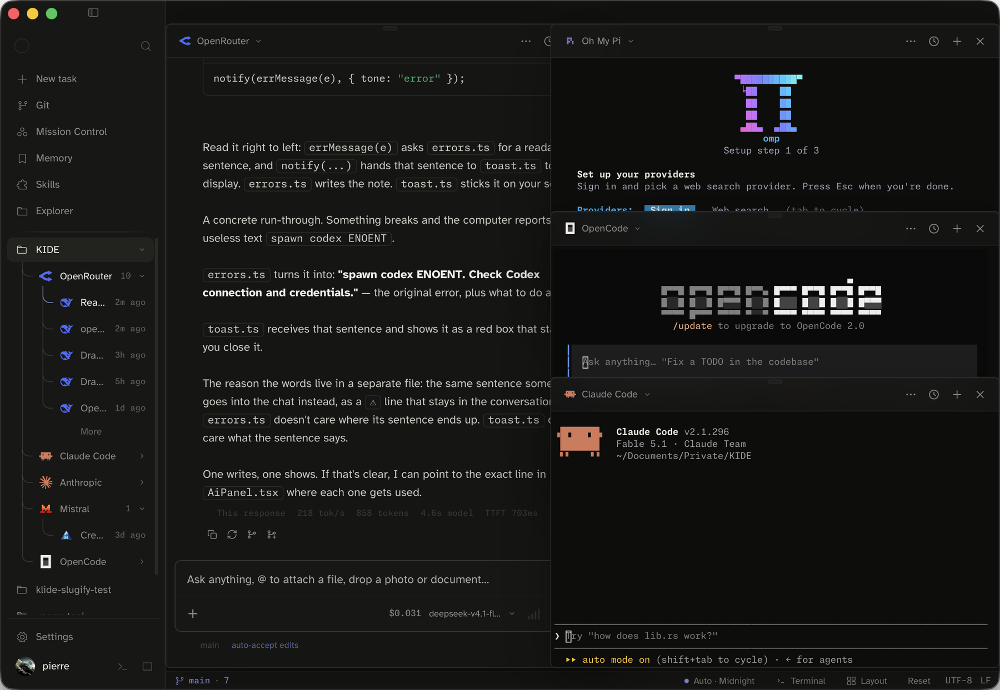
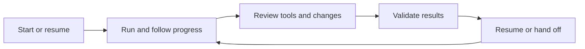
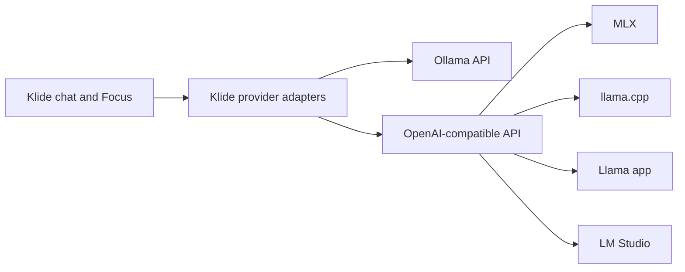

<div align="center">

# Klide

### Every agent visible. Every change reviewable.

A local-first coding workspace that runs local models and coding agents side by side — and lets any agent run on any intelligence.

<br/>


[](./LICENSE)

<br/>

[**Get started**](#get-started) &nbsp;·&nbsp; [Features](#features) &nbsp;·&nbsp; [Architecture](#trust-and-architecture) &nbsp;·&nbsp; [Contributing](#contributing)

</div>

## One workspace for every coding agent

Klide runs local models (Ollama, MLX, llama.cpp, Llama app, LM Studio), hosted APIs (Anthropic, OpenAI, Mistral, xAI, DeepSeek, OpenRouter, any OpenAI-compatible endpoint), and the coding agents you already pay for (Claude Code, Codex, OpenCode, Oh My Pi, Hermes, Amp, Cursor, Factory, or your own CLI) without hiding their native capabilities. You can inspect tool calls, follow terminal output, compare model cost and latency, and review changes from one workspace.

Klide keeps three questions in view:

- **What is running?** Mission Control tracks Klide runs and delegate command-line interface (CLI) sessions
- **What needs attention?** Waiting, blocked, failed, and reviewable work rises to the top
- **What changed?** Each run keeps its files, branch, transcript, validation state, cost, and memory evidence

And one rule most tools don't offer: **any agent, any intelligence.** The agent you like and the intelligence you can pay for are two separate choices. Keep Claude Code, Codex, OpenCode, or Hermes as the agent, and point it at an API key, a local model, a self-hosted endpoint, or a subscription. The conversation stays the agent's; the mark in your history shows what actually answered.

## Three ways to work

Klide opens on the surface that matches the task, and all three share the same runs, transcripts, conversations, and review state. One rail — projects, agents, and past conversations — stands on the left of every surface.

### Welcome — start or resume a project

Open a folder, start a new project, or clone a repository from one quiet page, with your recent workspaces numbered underneath. `⌘O`, `⌘N`, and `⌘⇧N` reach the three actions, and `⌘1`–`⌘5` reopen a recent workspace without touching the mouse. Beside the list, a framed big-pixel nature film drifts through five scenes in a calm loop.



### Focus — one task, one conversation

A single centered conversation on any agent: a local model, a hosted API, or a subscription CLI running headless, with no API key anywhere in Klide. Everything a run did before its answer folds to one line, a plan or a question opens as a card beside the conversation, an answer can draw a diagram in place, `⌘N` opens a second conversation beside the first, and the shared terminal docks under the canvas so a run keeps streaming while you shell.



### Workbench — the editor, with every agent on one canvas

The editor-first layout: explorer, tabs, Monaco, terminal, and AI panels. Anchor the panels, pick a fixed preset, build a grid, or float them freely over the editor — run a hosted model and the delegate CLIs side by side, each in its own live terminal, compare their answers, and keep the file you are reviewing open behind them.



## Why Klide

Coding agents work well in terminals, but their sessions, diffs, and evidence spread across separate tools. Klide keeps the real terminal experience and adds a shared operations layer around it.

| | |
|---|---|
| **Run real agents** | Use Claude Code, Codex, OpenCode, Oh My Pi, Hermes, Amp, Cursor, Factory, or a custom CLI inside persistent pseudoterminal (PTY) sessions, or as headless Focus turns |
| **Keep work visible** | See working, waiting, blocked, and completed runs across the workspace |
| **Review before trust** | Approve commands, inspect proposed edits, comment on diffs, and check validation evidence |
| **Any agent, any intelligence** | Keep Claude Code, Codex, OpenCode, or Hermes as the agent and choose what powers it: an API key, Ollama or MLX, a self-hosted endpoint, or a subscription such as Nous Portal |
| **Resume with context** | Reopen transcripts, share editable working notes across conversations and providers, and promote useful lessons to reviewed project memory |

## How work moves through Klide

The **Shared notes** icon in the conversation’s right-side panel opens a compact
summary. Use **Memory → Shared notes** to create a named set, select the
conversations that should share it, and save decisions, open
questions, and next steps. An answer's **Add to shared notes** action stages its
text for editing before you save. Linked chats read the saved notes on their
next turn, whichever provider they use. **Review lesson** extracts a
lesson into the existing review inbox; it becomes Project Memory only when you
keep it. See [Shared notes](docs/shared-notes.md) for scope and storage details.



Klide has two modes in the composer, and one command above them:

| Mode | Agent access |
|---|---|
| `Plan` | Reads the workspace and proposes an approach |
| `Work` | Edits and runs commands — the default. The foot bar sets the policy: review every edit, auto-accept edits, or full auto |
| `/goal <objective>` | One Work turn with a finish line: the run keeps going until the check you configured passes, and a failed check ends it in error |

A model that cannot call tools collapses to a tool-less chat. `Tab` toggles the mode.

## Features

| Area | Included |
|---|---|
| **Agent operations** | Mission Control, shared run lifecycle, attention queue, transcripts, session resume, cross-agent handoff, sub-agent visibility |
| **Any agent, any intelligence** | One nested selector — API, Local, Self-hosted, Subscription — for Claude Code, Codex, OpenCode, and Hermes. Keys stay in the process host and the CLI only ever sees a temporary loopback credential. Claude Code and Codex reach other wires through Klide's Messages and Responses adapters, OpenCode through its native provider config, Hermes through its own backends; reasoning effort follows the routed model. Pairs without an adapter yet (Oh My Pi, Amp, Cursor, Factory; one subscription CLI powering another) stay visible and say so |
| **Agent coordination** | One Rust-owned journal: runs address each other by a stable id, delegate CLIs join through an embedded MCP server, each Delegate session proves itself with its own secret, and another agent's words arrive in one fenced delivery, reviewed before they reach a conversation |
| **Connectors** | The MCP servers you already configured in Claude Code, Codex, or OpenCode, local or remote; the assistant calls them in Plan and Work (reads free, writes gated per tool), and GitHub connects in one click as the pinned account |
| **Background work** | Background shells a Run can read, stop, or be woken by; GitHub CI observer cards that follow a pinned run and open its PR in Git Review; subscription conversations that keep running after the app quits |
| **Workers** | `spawn_subagent` hands a task to a Delegate CLI as an approved, isolated Run of its own, watched live from the parent conversation or dispatched in the background with its report delivered when it settles |
| **Documents** | Native workbook tools that create and revise a recalculated `.xlsx` through the normal review path, plus a built-in sheet surface for `.xlsx` and `.sheet.json` |
| **Review and evidence** | Diff comments sent to agents, command approval, per-mode tool toggles enforced at dispatch, checkpoints, validation status, files touched, tokens, cost, and stop reasons |
| **Parallel work** | Git worktrees, worktree setup recipes, agent races on the same task, evidence comparison, and merge controls |
| **Editor and shell** | Monaco editor with eight themes, file explorer, tabs, search, command palette, Git review, commit graph, and persistent PTY terminals |
| **Workspace surfaces** | Welcome, Focus, and the Workbench with anchored, free-floating, fixed-preset, and freeform-grid layouts |
| **Models** | Ollama, MLX, llama.cpp, Llama app, LM Studio, Anthropic, OpenAI, Mistral, xAI, DeepSeek, OpenRouter, OpenAI-compatible endpoints, about forty more behind the opencodex gateway, and `auto`, which picks a rung from the task shape and each keyed provider's ladder, resolved once in Rust at run start with the reasoning recorded on the run |
| **Delegate CLIs** | Claude Code, Codex, and OpenCode (1 and 2) in persistent PTYs or as streaming Focus turns, with imported history, structured tool events, per-session MCP wiring, and account switching; Oh My Pi with imported history, streaming Focus turns but no MCP wiring yet; Hermes with ACP streaming Focus turns, observed tool activity, permission prompts, session continuity, and session-specific MCP (explicit reasoning effort retains the CLI path); Amp, Cursor, Factory, and custom CLIs in terminal sessions, Mission dispatch, and plain-text Focus turns; each CLI's own `/` commands in the composer, reasoning effort, `/config` drawn as a settings card, version and updater per CLI, and per-login usage in the account menu |
| **Sight** | A model without image support borrows another model's eyes: a dropped photo is described by a vision model, local-first, with the description and its attribution kept in the conversation |
| **Project context** | `AGENTS.md`, `CLAUDE.md`, file mentions, image and document attachments, skills, dynamic tools, search over previous conversations, native recall over reviewed Project Memory with provenance, lessons proposed for review after meaningful work, and `html` / `svg` visuals drawn in the answer |
| **From other apps** | `klide://` links open a pre-filled conversation, a file at a line, a project, or resume a CLI session; Ask Kit in the macOS Services menu sends selected text to a new conversation; a `/klide` skill lets Claude Code, Codex, OpenCode, or Oh My Pi hand its own session to Klide, and Kit can open one of theirs |
| **Local security** | Workspace-rooted file access, operating-system keychain storage, project command allowlists, network permissions, a user-choosable transcript folder with measured cleanup, and Rust deciding what a run may open, reveal, or must refuse |

OpenCode 2 is supported alongside V1, with native streaming, session resume,
slash commands, status callbacks and Mission Control history. Klide uses a
private V2 server to preserve each Run's MCP identity and recovers a dropped
stream from the durable transcript. V2 credentials stay managed by OpenCode;
Klide's file-snapshot account switcher remains V1-only. See the
[OpenCode delegate notes](docs/OPENCODE_DELEGATE.md) for details and the local
smoke test.

## Get started

Klide currently targets macOS. Apple Silicon is the primary development platform.

### Download the unsigned Apple Silicon build

Download the newest `.app.zip` attached to a release on [GitHub Releases](https://github.com/pierreprudh/KLIDE/releases), unzip it, and move `Klide.app` to Applications. Not every patch release ships a bundle — take the most recent release that has one.

This build is ad-hoc signed and is not Apple-notarized, and Klide is distributed through GitHub Releases only — there is no App Store listing and no notarization ticket. A file your browser downloads carries a quarantine flag, so on first launch macOS blocks it: *"Klide.app cannot be opened because Apple cannot check it for malicious software."*

Two ways past it. Open **System Settings › Privacy & Security**, scroll to Security, and click **Open Anyway** next to the blocked app — on macOS 15 and later this is the supported route, since Control-click › Open no longer bypasses the check. Or clear the flag yourself before launching:

```bash
xattr -dr com.apple.quarantine /Applications/Klide.app
```

Only do this for builds published from this repository. Notarization — which removes the prompt entirely — is deliberately deferred while distribution stays GitHub-only; see `TODO.md`.

### Prerequisites

- [Node.js](https://nodejs.org) 20 or later
- [Rust](https://rustup.rs) stable
- Optional: [Ollama](https://ollama.com) or [`mlx-lm`](https://github.com/ml-explore/mlx-lm) for local inference

### Build from source

Clone the repository and start the Tauri development build:

```bash
git clone https://github.com/pierreprudh/KLIDE.git
cd KLIDE
npm install
npm run tauri dev
```

The first Rust build takes about three to five minutes. Later builds reuse the compiled dependencies.

Once Klide opens:

1. Open a workspace folder from Welcome
2. In Focus, or in the Workbench's AI panel, pick an agent in the composer: a local model, a hosted API, or an installed CLI
3. Press `Tab` in the composer to switch between `Work` and `Plan`
4. Open Mission Control from the rail to follow active and completed work

`⌘P` jumps to a file, `⌘⇧P` opens the command palette, and `⌘/` shows the full shortcut cheatsheet.

One task, end to end:

1. Open a folder and select `Ollama` in the composer's agent selector
2. Leave the composer's `+` menu on `Work` — the default — or press `Tab` to reach `Plan`
3. Describe the change and press `↵`
4. The note under the composer reads `reviewing edits`: `Validate` applies the edit, `Cancel` drops it, `Request changes` sends your note back to the agent, and `⤢` opens the changes in the editor
5. Press `⌘⇧G` to see the applied edit in `Git Review`, or open `Mission Control` to follow the run

## Use the Klide model

[`pierreprudh/klide-8b`](https://ollama.com/pierreprudh/klide-8b) is a Low-Rank Adaptation (LoRA) fine-tune of LFM2.5-8B-A1B. It is trained for Klide's tool and edit contract.

```bash
ollama pull pierreprudh/klide-8b
```

The model appears in Klide's Ollama picker after the download finishes.

## Local inference

### Providers

| Provider | Setup | Endpoint | Managed by |
| --- | --- | --- | --- |
| Ollama | Install Ollama; select a downloaded model in Klide | `localhost:11434` | Klide can start and stop the server |
| MLX-LM 0.31.3¹ | Install `mlx-lm`; start from Settings → Local AI | `localhost:8080` | Klide can start and stop the server |
| llama.cpp | Choose a model in Settings → Local AI; install and start in one action | `localhost:8081` | Klide |
| [Llama app](https://llama.app) | **Llama → Llama app → Get Llama** in Settings → Local AI; choose a model in Llama, then select it in Klide | `localhost:9931/v1` | Llama app; Klide discovers its models |
| LM Studio | Start its local server; select LM Studio in Klide | `localhost:1234/v1` | LM Studio |

Llama app discovers the shared GGUF cache. Set its model context to at least **16k**
for Klide’s tool prompts; its automatic 4k choice for the tested 3B model was too small.
Klide-managed llama.cpp starts with 16k context.
See the [live setup and tool smoke test](scripts/local-inference/results/SMOKE.md)
for verified behavior and the tested small model’s limitations.

Settings → Local AI groups both llama.cpp setups under **Llama**, with a **Klide / Llama app**
switch. It remembers the selection and shows only that Llama setup in the AI and Focus provider selectors.
Switching the setup does not start or stop a server or change existing conversations.

Hermes (`hermes`), Amp (`amp`), Cursor (`cursor-agent`), and Factory (`droid`)
also appear in Settings → Subscription and the agent pickers; an installed CLI
sorts first and a missing one is dimmed. Install and configure each CLI with its
own setup flow. All four support interactive terminal sessions and one-shot
Mission dispatch. Hermes Focus turns use ACP for streamed answers, observed tools,
permission prompts, session continuity, and session-specific MCP. Explicit
reasoning-effort selections retain the plain-text CLI path; imported CLI history
and account switching remain unsupported. Amp, Cursor, and Factory retain
plain-text Focus turns; Amp manages model selection itself. Hermes, like Claude Code, Codex, and
OpenCode, can run on any intelligence source Klide knows — see the feature table
— and Settings → Subscription → Hermes API setup holds its configured default.
DeepSeek is a native API provider using `DEEPSEEK_API_KEY`. Official setup links
and logo sources are listed in [Provider resources](docs/PROVIDER_RESOURCES.md).

### Connection flow



Choose the provider in Klide, then choose a model available through that server.

### llama.cpp models

| Model | Quantization | Download | Estimated memory at 16k context |
| --- | --- | ---: | ---: |
| [Klide 8B](https://ollama.com/pierreprudh/klide-8b) | Q8_0 | 9.01 GB | 12.5 GB |
| [Qwen3 8B](https://huggingface.co/Qwen/Qwen3-8B-GGUF) | Q4_K_M | 5 GB | 8 GB |
| [Llama 3.2 3B](https://huggingface.co/bartowski/Llama-3.2-3B-Instruct-GGUF) | Q4_K_M | 2.02 GB | 4 GB |
| [Ministral 3 3B](https://huggingface.co/mistralai/Ministral-3-3B-Instruct-2512-GGUF) | Q4_K_M | 2.15 GB | 4.5 GB |

Klide detects the chip, RAM and CPU cores to recommend a model, favouring smaller
models on CPU. Memory figures estimate fit, not speed; other apps reduce available memory.

| Setup detail | Behavior |
| --- | --- |
| Installation | Download only llama.cpp, or install and start the selected model in one action; no Homebrew or administrator password needed |
| Runtime | Official release with verified checksum in `~/.klide/runtimes/llamacpp`; an existing `llama-server` on PATH is reused |
| Models | Cached after download; Klide's Q8 GGUF comes from its Ollama registry layer with a pinned SHA-256 check |
| Selection | Saved in `~/.klide/llamacpp.json`, shared by chat and Focus; stop before changing models |
| Server ownership | Stop terminates Klide-launched servers; external servers must be stopped externally |
| Platforms | Automatic runtime installation supports macOS; other platforms need an installed `llama-server` |

### Provider benchmark

**No clear performance advantage from switching engines was demonstrated.**

| Measurement setup | Value |
| --- | --- |
| Date and machine | 2026-10-06; Apple M5, 16 GB RAM, Metal |
| Model | Identical Klide 8.5B Q8_0 GGUF |
| Settings | Context 8,192; output cap 256; temperature 0; seed 42; thinking disabled |
| Method | Median of three post-warmup trials through Klide's streaming adapters; one engine loaded at a time; loading excluded |

| Task | Ollama 0.35.1 | llama.cpp 8950 | MLX-LM 0.31.3¹ | Result |
| --- | ---: | ---: | --- | --- |
| Requested `read_file` call | 282 ms | 299 ms | 2,477 ms | Ollama/llama.cpp: 3/3 structured calls; MLX: correct call as text, 0/3 structured calls |
| Short explanation | 338 ms | 323 ms | 5,387 ms | Ollama/llama.cpp: unwanted tool call; MLX: reasoning only at token cap |
| Long project summary | 289 ms | 271 ms | 5,947 ms | Ollama/llama.cpp: unwanted tool call; MLX: reasoning only at token cap |

¹ MLX used **LFM2.5-8B-A1B MLX 8-bit + the local Klide checkpoint 1400 LoRA**,
not the merged Q8_0 GGUF. It emitted reasoning despite the thinking-disable request.
These are observed request timings, **not a controlled three-engine speed ranking**.
All MLX trials completed without HTTP errors; plain-text tasks produced no final
answer within 256 tokens. The tool task emitted the correct pythonic call as text,
not a structured `toolCalls` entry. This test does not establish full-harness tool failure.
MLX had no enforced 8k context cap; the largest prompt used 2,859 tokens.
The benchmark requested streamed usage for accounting; normal Klide MLX settings leave it off.

| Interpretation | Limit |
| --- | --- |
| Tool latency | llama.cpp was about 6% slower in this small sample; insufficient to rank engines generally |
| Failed text tasks | Timings do not represent useful text generation; model/prompt behavior needs investigation |
| Tool parsing without supplied tools | llama.cpp exposed tool syntax as text; Ollama parsed it as a tool call |
| Scope | Adapter benchmark; no full coding-agent workflow or workspace tool execution |
| Comparability | Repeated prompts benefit from caching; tool templates yield different token counts; results depend on hardware and settings |
| MLX comparison | Measured with cached LFM2.5-8B-A1B MLX 8-bit weights plus local Klide checkpoint 1400; published GGUF equivalence unverified |
| Other unmeasured providers | LM Studio and Llama app |

| Evidence | Link |
| --- | --- |
| Full report | [Method and limitations](scripts/local-inference/results/REPORT.md) |
| Raw trials | [Ollama](scripts/local-inference/results/ollama.json) · [llama.cpp](scripts/local-inference/results/llamacpp.json) · [MLX](scripts/local-inference/results/mlx.json) |
| Reproduction | [Commands and prerequisites](scripts/local-inference/README.md) |

## Trust and architecture

Klide separates the interface from the durable execution layer:

| Layer | Responsibility |
|---|---|
| **React and TypeScript** | Editor, panels, review surfaces, layouts, and run projections |
| **Tauri and Rust** | Agent harness, provider streaming, tools, permissions, PTYs, Git, keychain, and filesystem access |
| **JSON Lines (JSONL) transcripts** | Append-only run events used by Mission Control, validation, memory, and replay |

The Rust harness checks capabilities when it advertises tools and again before execution. Writes pause for diff review. Commands and network access pause for permission.

Read the [Harness contract](./docs/HARNESS_CONTRACT.md) for the trust model and [Harness schema](./docs/KLIDE_HARNESS_SCHEMA.md) for the tool interface.
The [Memory Engine](./docs/MEMORY_ENGINE.md) and [Project Memory schema](./docs/KLIDE_MEMORY_SCHEMA.md) describe Klide's local learning layer and its authenticated MCP search/read boundary for supported Delegates.
The [Agent Coordination architecture](./docs/AGENT_COORDINATION.md) and [coordination schemas](./docs/KLIDE_COORDINATION_SCHEMA.md) define stable Run addressing, durable envelopes, replay, and the shared adapter boundary for native agents and Delegates.

## Project status

Klide is under active development. Its frontend tests, production build, Rust suite, PTY socket integration, and release-bundle boot check pass. Unsigned Apple Silicon bundles and source builds are available now. Distribution is GitHub Releases only and the bundle is ad-hoc signed; notarization is deferred by choice, so first launch needs the Open Anyway step above.

The current line is **0.6.10** (2026-10-13). On main since then, unreleased:

- **Any agent, any intelligence** — Claude Code, Codex, and OpenCode run on Klide's API keys, local and self-hosted endpoints, and Nous Portal without changing the agent; reasoning effort follows the routed model; a conversation keeps the agent it began on and its history mark shows the model that powers it

Recent cuts, each under the name it shipped with:

- **0.6.10** (2026-10-13) — Amp, Cursor, Factory, and Hermes as CLI providers with official marks; Hermes on any API, local, or self-hosted source; harness/model independence recorded as a product principle
- **0.6.9 — OpenCode 2** (2026-10-12) — native answer and reasoning streaming, durable recovery, session resume, native commands, complete model discovery, provider commands first in the `/` menu
- **0.6.8** (2026-10-07) — Sight, so a model without image support borrows another model's eyes; app and background runs share admission and crash recovery; the Memory inbox; Mistral metadata; agent commands in the login shell's environment; the Welcome film
- **0.6.7** (2026-10-06) — managed llama.cpp at 16k context, Llama app as a local provider, the local inference benchmark below
- **0.6.6** (2026-10-05) — a failed `/goal` check ends the run in error; Project Memory proposes evidence-backed lessons for review
- **Since v0.6.5** — GitHub observer cards, Claude Code effort, connectors the assistant can call with one-click GitHub, each CLI's own `/` commands, `klide://` links and Ask Kit, subscription conversations that keep running after the app quits, OpenCode turns that stream, usage per CLI in the account menu, the Cerulean theme, Tools per mode enforced at dispatch, and CLI sessions both ways: `klide://resume` and the `/klide` skill hand a Claude Code, Codex, OpenCode, or Oh My Pi session to Klide, and `list_cli_sessions` / `open_cli_session` let Kit open one

Underneath, the September architecture review landed as nine merged pull requests: **one Gate subject** every permission check reads, **a Run lease** that releases everything it holds however the loop ends, **one fenced delivery** for everything the operator did not type, **a per-session bridge secret** for Delegate CLIs, and the rest of the seams Mission Control, the Harness, and the Delegates now share.

v0.6.4 — Workers, Connectors, Visuals (2026-09-20) let a Harness Run hand a task to another CLI agent as a worker — a dispatch the operator approves, an isolated worktree, a Run of its own — connected Klide to the MCP servers already configured in the tools you use, and let an answer draw a picture in the conversation. v0.6.3 — Coordination and Documents let Runs address each other through one Rust-owned journal, with every agent's words reviewed before they reach a conversation, and let a run write a real `.xlsx` that Klide recalculates and opens. v0.6.2 — Memory, Routing, Recovery gave the agent native recall over reviewed Project Memory, resolved the `auto` model choice once in Rust at run start, and made a run near the turn cap finish instead of erroring. v0.6.1 — Subscriptions and Reach let Focus use every provider Klide supports, ran delegate CLIs there on their own subscription, and added around forty upstreams behind the opencodex gateway.

The v0.6 orchestration milestone itself — Missions as outcomes, budget and capacity in the dispatch path, capability routing, automatic validation contracts — is still open, so treat those surfaces as unfinished.

Current priorities:

- Dogfood the new intelligence routes live: Claude Code on Ollama, Codex on DeepSeek and on the Anthropic wire, OpenCode on a local model, Claude Code on Nous Portal
- Close the pairs without an adapter before "any" goes on a landing page: Oh My Pi, Amp, Cursor, Factory, and one subscription CLI powering another
- v0.5.1: dogfood the spreadsheet path and the full race/restart/permission/merge/cleanup path in the app
- v0.5.1: notarize the macOS bundle, then validate Windows and Linux
- v0.6: make Missions the primary outcome, with visible budget and capacity, capability routing, automatic validation contracts, and durable background execution with local-to-cloud handoff

See the [changelog](./CHANGELOG.md) for shipped milestones.

## Development

Run the relevant checks before submitting a change:

```bash
npm test
npm run build
cargo test --manifest-path src-tauri/Cargo.toml
```

The frontend lives in `src/`. The Rust backend lives in `src-tauri/`.

## Contributing

Issues and pull requests are welcome. Keep changes focused, preserve the workspace trust boundary, and include validation for changed behavior.

## Acknowledgments

Klide is built with [Tauri](https://v2.tauri.app), [Monaco](https://microsoft.github.io/monaco-editor/), and [xterm.js](https://xtermjs.org). Its product influences include Ara, Cursor, Cline, Linear, and the open coding-agent ecosystem.

## License

Klide is available under the [MIT License](./LICENSE).
