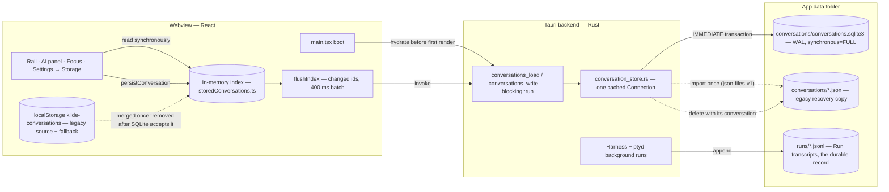
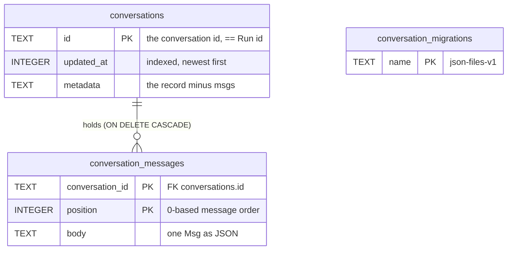

# Conversation store — from localStorage to SQLite

The **conversation index** is the list of Stored conversations the rail, the AI
panel history and Settings → Storage read: each thread's title, Provider,
model, Workspace, lineage and its `Msg[]` snapshot. It is a cache for the
interface. The durable record of what a Run did is still its JSONL Transcript
under the runs folder; nothing here replaces or rewrites a Transcript.

## Three homes, in order

| Era | Where | Why it moved |
|---|---|---|
| ≤ v0.6.10 | webview `localStorage`, key `klide-conversations` | WebKit gives the whole app ~5 MB. At ~200 KB a thread (mostly tool output) that held about eight conversations; each new one evicted an old one. |
| 2026-10-23 (`18af281`, never released) | `<app data>/conversations/<sha256(id)>.json`, one file per thread, cap 300 | No quota, but a file per thread is a folder of whole-document rewrites, and the cap still dropped history. |
| now | `<app data>/conversations/conversations.sqlite3` | Transactions, no count cap, and a thread's messages are rows: a streamed token rewrites only the messages that changed. |

`<app data>` on macOS is `~/Library/Application Support/com.pierre.klide/`.

## Infrastructure



The index is a cache in front of the transcripts. Losing `conversations.sqlite3`
loses the list and its snapshots, but no record of a Run: Mission Control still
reads `runs/`.



## Shape

```sql
conversations         (id TEXT PRIMARY KEY, updated_at INTEGER, metadata TEXT)  -- record minus msgs
conversation_messages (conversation_id → conversations ON DELETE CASCADE,
                       position INTEGER, body TEXT, PRIMARY KEY(conversation_id, position))
conversation_migrations (name TEXT PRIMARY KEY)  -- 'json-files-v1' once imported
```

Rust stores opaque JSON: the record's shape belongs to the renderer
(`src/components/ai/storedConversations.ts`). Rust only checks that a record
is an object, carries a `msgs` array, and that its `id` matches the key it was
sent under. The database runs in WAL mode with `synchronous=FULL`.

One connection per database is opened on first use and kept
(`conversation_store.rs`, `with_store`). The renderer flushes every 400 ms
while a turn streams; each flush is one `IMMEDIATE` transaction.

## The two migrations

Both run automatically on the first launch of a build that has them.

1. **Legacy JSON files → SQLite** (Rust, in `open`). Inside one write
   transaction: every `*.json` in the folder that decodes as a record is
   inserted unless SQLite already has that id; then the `json-files-v1`
   marker is written. All or nothing — an unreadable file (an IO error, not a
   corrupt record) aborts the import, nothing is published, and the next
   launch retries. A corrupt file is skipped and counted. Run `*.jsonl` files
   are never touched. The marker means a conversation deleted after the import
   is never imported again.
2. **localStorage → SQLite** (renderer, `hydrateConversationStore`). The old
   localStorage index is merged in, the newer copy of each thread winning, and
   the key is removed only after SQLite accepts the write.

The JSON files are kept after import as a recovery copy of the state at
migration time. Deleting a conversation also deletes its file.

## Failure behaviour

| What breaks | What the user sees |
|---|---|
| A stored row no longer decodes | That thread is hidden and counted in a warning toast; the rest loads. Rewriting the thread repairs it. |
| Legacy files skipped by the import | Counted once, on the launch that imported. |
| The database cannot be opened | An error toast; that window falls back to localStorage. The SQLite file and Transcripts stay on disk, and the next good launch merges what the fallback saved. |
| A write fails | The batch rolls back, the renderer keeps the work pending and retries on the next save, one toast. |

## Review — 2026-10-24

The import itself was verified on real data: the 9 legacy files of the dev
app were imported with identical message counts per thread (11 conversations,
381 messages after). Findings, fixed the same day:

1. **A deleted conversation survived in its JSON recovery copy.** Deleting
   removed the SQLite rows only. `write` now deletes `<sha256(id)>.json` after
   the commit; a failure there returns an error so the renderer retries.
2. **One undecodable row failed the whole load**, which dropped the window to
   an empty localStorage index. Bad rows are now skipped and counted, as the
   file store did.
3. **Every flush reopened the database**, re-ran the schema and took the
   write lock twice. The connection is now opened once per process.

Tests: `deleting_a_conversation_removes_its_legacy_recovery_copy`,
`a_corrupt_row_is_counted_and_never_hides_the_rest`,
`unreadable_legacy_files_are_reported_on_the_first_load_only`.

### Still open

- **Everything is hydrated into memory before the first render.** The 300
  cap is gone, so boot time and memory grow with history (~200 KB a thread:
  1,000 threads is ~200 MB of JSON parsed at launch). SQLite makes the fix
  available — hydrate metadata only and load a thread's messages when it is
  opened — but every surface reads the index synchronously today, so that is
  its own change.
- **Downgrade.** An older build reads the stale JSON files (or localStorage)
  and does not see anything written to SQLite.
- `updated_at` is read with `as_i64`; a fractional timestamp sorts as 0 in
  SQL. The renderer re-sorts, so only the SQL order is affected.

## Resuming a conversation with another agent

A cross-agent resume keeps the imported messages visible in the conversation
index, but does not send that entire history to the receiving model. Its first
turn carries a bounded handoff (original request, latest request and last
reported state, explicitly marked as excerpts) and the last three non-empty
user/assistant messages. Each recent message is capped at 1,600 UTF-16 code
units; older text and tool outputs stay out of this prompt.

The complete imported user/assistant prose travels over local IPC in
`conversationHistory`, separately from provider attachments. Before dispatch,
Rust stores it privately through `durable.rs` in
`<runs>/<conversation-id>.history.json`, together with its workspace. The
pending-handoff flag is cleared only after Rust accepts the Run. Retrying a
start does not replace the original archive. Imports over 8 MB are refused
explicitly rather than silently losing history.

`search_conversations` accepts a specific conversation id, or `current` for
this imported snapshot. Results identify matching message numbers;
`read_conversation` reads exact text by message number and character offset,
with pages capped at 16,000 characters. Without a conversation id, search
continues to find prior workspace conversations, including their imports.
Native tools and the authenticated Delegate MCP bridge share the same Rust
registry and workspace checks; these two retrieval tools are available in
Chat as well as Plan and Goal. The archive is historical evidence, never a
source of new instructions or reviewed Project Memory.

Retrieval is local text search, with no embedding model or external vector
database. Only the handoff, recent excerpts, and requested tool results enter
provider context. Existing native CLI resumes still use the CLI's own session.
