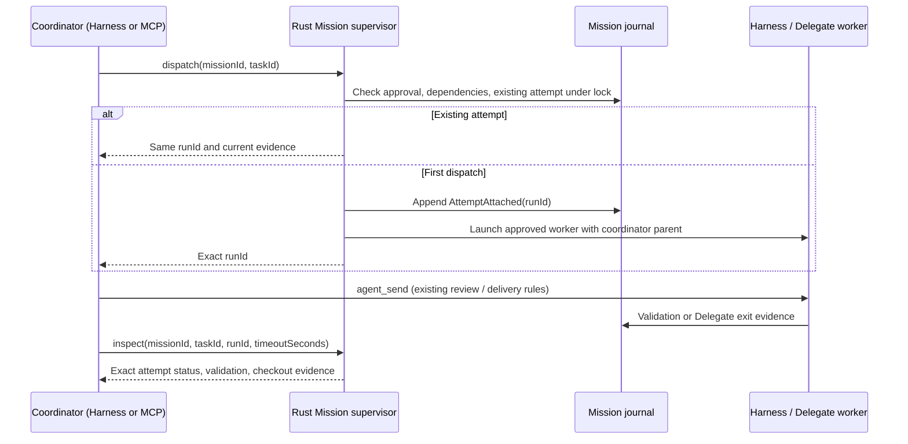

# Agent-driven Mission orchestration

A Goal Harness Run or a Delegate MCP client can use `mission_orchestrate` to
find approved tasks, dispatch a worker, and inspect its exact attempt. Both
adapters call the existing Rust Mission supervisor. No renderer must stay mounted.

## Planning from a conversation

`/mission <objective>` in a Work conversation asks Kit for a plan, not for the
work. The Run calls the native Tool `plan_mission` once — title, intent, and
3–8 tasks with ids, phases and `dependsOn` — and Rust writes the draft beside
the Run (`.klide/missions/<id>/`, every task `dispatch: None`). The receipt
names the Mission and the route this Run would give it (its own resolved
provider and model, as a Delegate worker when the provider is a CLI). The
conversation draws the draft as a card; **Approve and run** on that card is
the operator's `mission_approve` with `autoStart`, which freezes each chosen worker route
into its task and hands the Mission to the supervisor. The card then follows
the durable events until the Mission completes or parks, and offers the
Accept / Reject verdict for a Delegate attempt in review. Nothing in the Tool
can approve, route, dispatch or accept; a worker inside a Mission cannot plan.

## Workflow

The operator plans in a conversation with `/mission`, edits task details,
acceptance criteria and dependencies on the card, and chooses each worker’s
provider, model and diff-review policy before approval. Approval freezes those
settings, including command approval. The operator can change execution policy
on the card while a Mission runs: future tasks use the saved policy, active
native workers receive the override, and newly auto-approved edit or command
pauses are released. Switching back to Review affects subsequent edits and
commands; it does not undo accepted changes. Full auto disables edit and command
prompts for native workers; Delegate completion still requires operator
acceptance. Old Mission snapshots default to prompting for commands. The card follows worker permissions, diff reviews and questions,
offers Delegate verdicts and explicit retries for parked work, and opens each
worker in Mission Control for inspection. Mission Control also lists saved
Missions so plans remain reachable after their conversation closes. The
separate Orchestrator console is no longer a navigation destination.

The coordinator then
uses the same tool through native Harness calls or MCP:

```json
{"action":"list"}
```

```json
{"action":"dispatch","missionId":"release","taskId":"tests"}
```

Keep the returned `runId`. Use `agent_send` for a follow-up to that Run; the
existing receiving-operator review and safe-delivery rules still apply. Then
inspect that exact attempt, optionally waiting for up to 120 seconds:

```json
{"action":"inspect","missionId":"release","taskId":"tests","runId":"run_123","timeoutSeconds":30}
```

`timeoutSeconds: 0` (the default) is an immediate snapshot. `timedOut: true`
means the exact attempt has no terminal Mission evidence yet. It never cancels
work. Cancellation of the coordinator likewise does not roll back a durable
Mission dispatch.

## Receipt and evidence

The [JSON Schema](../schemas/klide-mission-orchestration.schema.json) is embedded
in the MCP output schema. Native tool metadata contains the same JSON value.

| Status | Meaning | Accepted? |
|---|---|---|
| `running` | Attached; no terminal Mission event yet | Unknown |
| `awaiting_review` | Delegate process exited | Unknown, even for exit code 0 |
| `accepted` | Mission validation accepted this attempt | Yes |
| `rejected` | Mission validation rejected this attempt | No |
| `dispatch_failed` | Launch failed after durable attachment | Unknown |
| `interrupted` | Recovery recorded an interrupted attempt | Unknown |

Inspection includes the recorded validation checks, exit code when available,
failure reason, and the Harness transcript summary when present. Missing summary
is `null`; it is never interpreted as success. A Delegate's self-published
coordination result remains available through `agent_read_result` and does not
replace operator review.

Checkout evidence includes HEAD, bounded diff statistics against HEAD, and
porcelain status. It is explicitly **shared checkout evidence**, not a patch
attributed to one attempt. It excludes committed changes and file contents;
untracked names appear in status. Git errors are returned as unavailable
evidence, not as a clean checkout. Review the actual branch/files before merging.

## Authority and retries

- No tool argument supplies an actor, workspace path, provider override, plan
  approval, acceptance, retry instruction, or merge command.
- Top-level Runs may coordinate the workspace's approved Missions. A worker
  assigned to a Mission is confined to it; an unassigned child cannot enumerate
  or dispatch other Missions. Unregistered Runs are refused.
- Native orchestration is offered and enforced only in Goal mode. MCP serves
  independently capable Delegate CLIs, as with the existing coordination tools.
- The normal Mission gate still requires approved dispatch settings and accepted
  dependencies. Agent dispatch will not add another attempt while a different
  attempt is active or awaiting review (the calling coordinator is excluded).
- Under the Mission writer lock, the attachment is persisted before launching.
  A repeated dispatch returns the latest existing attempt, including a failed
  attempt. It never silently retries or starts another paid worker. Intentional
  retries remain in Mission Control, where Run is a request to the supervisor
  (`mission_request_task`), not a second dispatcher.
- `plan_mission` persists its authenticated planning Run as the coordinator.
  Card-launched workers retain that parent in both Harness and Delegate paths,
  so Mission Control groups them as subagents. Native workers share the
  `spawn_subagent` child launcher and retain their Mission validation contract.
  Legacy Missions without a recorded coordinator retain their existing lineage.
- A coordinator in a linked worktree uses Missions authored there when present;
  otherwise it discovers Missions in the owning checkout. Existing worktree-local
  Missions are preserved.



## Remaining orchestration work

## Isolated attempts

In a Git project, each Mission attempt works in a worktree of its own
(`src-tauri/src/missions/isolation.rs`, 2026-10-29). The first dispatch makes
the Mission branch `klide/mission-<id>` at the checkout's HEAD; each attempt
forks `klide/mission-<id>-<task>-<run>` from that branch's tip, and the journal
records it as `attempt_checkout_prepared` before anything runs there.

Acceptance integrates before it is recorded. A Harness attempt that validates,
or a Delegate attempt the operator accepts, has whatever it left uncommitted
committed, then fast-forwards the Mission branch (`attempt_integrated` with the
commit), and its worktree and branch are removed. Because the supervisor runs
one attempt at a time and only acceptance moves the Mission branch, the
fast-forward holds; if the branch moved anyway, the attempt is not accepted, a
failed `mission-integration` check says why, and its worktree is kept. A
dependent task therefore starts from the exact commit its dependencies were
accepted at, and `inspect` reports the attempt's own diff against its base
commit (`exclusive: true`).

The checkout is never written to by a Mission. The completion report names the
Mission branch, and the Mission card offers **Merge into <branch>** while the
branch holds work the checkout lacks.

Not isolated: folders that are not Git repositories, and Missions that had
already run an attempt in the checkout before this change (their accepted work
may be uncommitted there). The recipe's copy and link steps run in an attempt
worktree; its setup script does not, because plan approval does not show it
yet. A rejected attempt's worktree stays until the operator discards it.

## Remaining orchestration work

This interface connects the durable workflow; it does not yet reproduce the
full isolated-worker workflow documented by
[Superset](https://docs.superset.sh/orchestration): no parallel attempts within
one Mission, and no setup script in attempt worktrees.

Delegate messages remain pull-based through `agent_wait`. Automatic wakeups,
recoverable delivery acknowledgements, and automatic integration are unchanged.
These limits are surfaced here and in the tool description rather than being
inferred from a process exiting or a terminal becoming idle.

Completion writes an atomic `report.json` beside the Mission event log before
recording `mission_completed`. The report uses accepted attempt transcripts,
worker models, changed paths and recorded verification; it does not make another
model call. Completed older Missions receive a report on the next listing.
The planning chat delivers the report as a persisted assistant message, once
per Mission, when idle or reopened. Its Focus side column follows the same
Mission card and report as Mission Control. CLI attempts without a written
Harness result show an explicit transcript link instruction rather than an
invented answer.
