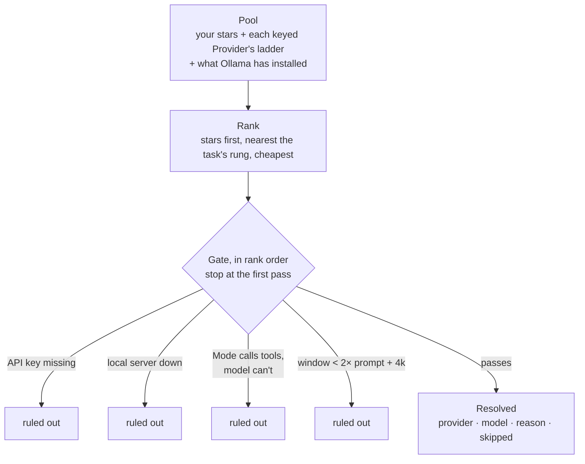

# Model routing — the `Auto` Provider

How Klide picks a model when the user doesn't. This document is the reasoning
behind `src-tauri/src/agent/routing.rs`; the code is the rule, this is why the
rule looks the way it does and what it deliberately is not.

Vocabulary is `CONTEXT.md`'s: **Provider**, **Run**, **Mode**, **Harness**,
**Transcript**. `Auto` is defined there too.

## The one-sentence version

**Rule out, then choose, then lock it in — and write down who did the work.**

Auto is a gate followed by a preference. The gate is not a score: nothing a
model does well puts it back in the pool once it has been ruled out. The
preference is the user's own — their stars — and, when they starred nothing,
a **rung** read off the task shape: Chat is light, Plan and Goal are
standard, a big brief is strong. Each Provider row names one model per rung.
Nothing learned, nothing called in front of the message.

## Where it lives

```mermaid
flowchart LR
    P[Picker<br/>provider = auto] -->|StartRunRequest<br/>+ preferredModels| S

    subgraph Rust — start_run
        S{provider == auto?} -->|no| F[failure budget → loop]
        S -->|yes| O{transcript has<br/>a RunStarted?}
        O -->|yes — continuation| L[reuse origin pair<br/>locked]
        O -->|no — first turn| R[routing::resolve]
        R --> F
        L --> F
    end

    F --> E1[RunStarted<br/>resolved provider + model]
    E1 --> E2[RouteResolved<br/>reason + skipped]
    E2 --> E3[ContextSnapshot → UserMessage → …]
```

Every Run — an AI panel turn, a headless Mission attempt, a nested subagent —
enters through `start_run` in `agent/mod.rs`. Resolving there means nothing
downstream ever sees the word `auto`: the failure budget keys on the real pair,
the run summary names it, `RunStarted` carries it, the adapters dial it. There
is one router and one place it runs.

## The rule



**Pool.** The user's starred pairs (every picker's star list, sent on the
request as `preferredModels`), each keyed hosted Provider's **ladder**, and
every model Ollama reports installed. Delegate CLIs are never candidates:
they run on a subscription with their own trust and cost model, and a routed
run has to stay inside the Harness.

**Rungs.** Three steps — `light`, `standard`, `strong` — and a Provider row
names one model per step (`AutoLadder` on the `ProviderEntry`, `NO_LADDER`
on local and subscription rows). The task shape picks the step, in
`rung_for`: Chat is light, Plan and Goal are standard, and a first turn of
16k tokens or four attached files bumps one rung up. An installed local model
sits at `light`. A ladder slot may be empty (xAI names no light model); the
nearest rung that has a candidate answers instead. The ladder is the day-one
pool: a fresh install with one API key and no stars gets a pick.

| Row | light | standard | strong |
|---|---|---|---|
| Anthropic | claude-haiku-5-5 | claude-sonnet-5-5 | claude-opus-5-5 |
| OpenAI | gpt-5-mini | gpt-5 | — |
| Mistral | mistral-small-latest | mistral-medium-latest | mistral-large-latest |
| xAI | — | grok-4 | — |
| DeepSeek | deepseek-chat | deepseek-chat | deepseek-reasoner |
| OpenRouter | openrouter/auto | openrouter/auto | openrouter/auto |

OpenRouter's row puts its own router on every rung: `openrouter/auto` is a
trained classifier over their whole marketplace, run inside the request
Klide was sending anyway. A user whose only key is OpenRouter gets that
router for free; a user with a direct key beside it gets the direct model,
because an unpriced candidate ranks after every priced one.

**Rank.** Two tiers, stable within each:

| Tier | Members | Order inside the tier |
|---|---|---|
| 1 | starred | nearest the task's rung; then cheapest, unknown price last |
| 2 | ladder + local | nearest the task's rung; then Ollama's default; then cheapest |

**Price** is blended the way an agent turn spends tokens: three input to one
output, `(3·in + out) / 4` per million (`models::model_blended_price`). Input
alone misranks: OpenRouter lists `z-ai/glm-5.2` at $0.03/M in — the floor of
34 endpoints, one fp4 host — and $7/M out, and it billed ~$0.62/M in on the
endpoint OpenRouter actually routed to. Blended it is $1.78/M.

A starred model takes its rung from its Provider's ladder. A star on no
ladder — an OpenRouter model, a self-hosted one — takes the rung its blended
price sits at (`rung_for_price`): under $0.75/M is light, from $6/M strong,
standard between; the bands are read off the Anthropic and OpenAI ladders
(Haiku and gpt-5-mini under the first, Opus over the second), and a test
keeps them agreeing. Only an unpriced star on no ladder ranks as if it sat
at the wanted rung. Before this, every star on no ladder sat at every rung,
so with a dozen OpenRouter stars the cheapest-to-ask won every job. A
local model is free, so at its rung it leads every hosted one — Chat goes
local — and at the wrong rung a keyed model that fits the job leads it — a
Goal goes to the standard model. Stars reorder this; nothing else does.

Ties break on provider name, then model name. A router that picks differently
on identical input is a bug, so the order is total.

**Gate.** Candidates are asked in rank order and the walk stops at the first
that passes. A starred model that fits costs one probe, not one per installed
model. What the gate asks:

| Check | Source | Rejection recorded as |
|---|---|---|
| hosted Provider has a key | `providers::provider_key` | `no API key` |
| the key's own `/models` listing names the model (a dated snapshot counts for its alias; no listing, no verdict) | `models::key_lists_model` | `not in this key's model list` |
| local server is up | `local_servers::local_server_is_up` | `server not running` |
| the model can answer a message (an Ollama embedding model can't) | `model_capabilities::capabilities` | `embedding model, cannot chat` |
| tool support, when the Mode is Plan or Goal | `model_capabilities::capabilities` | `cannot use tools` |
| context window ≥ 2 × prompt tokens + 4 096 | `model_capabilities::capabilities` | `Nk window, job needs Mk` |

Chat does not require tools. The window floor is deliberately unclever: the
prompt needs room to be answered and to grow a few turns before compaction.
Both facts come from the one capabilities answer the gauge also shows — an
Ollama candidate's window is the daemon's probed number, not a name guess —
and a window nobody published plans as `DEFAULT_CONTEXT_WINDOW` (128k), the
one place that number lives.

**Lock.** A continuation of an `auto` conversation reuses the pair its own
Transcript recorded (`read_run_origin`) and emits no `RouteResolved`. Context
accounting, compaction and the provider's prompt cache are all per model;
switching mid-thread would invalidate all three. Copilot's own docs say the
same thing from the other side — routing happens "along natural cache
boundaries" because mid-session switching "has shown increased cost without
ample improvements in quality."

## OpenRouter's router decides among your OpenRouter stars

Price and names are poor stand-ins for how good a model is: DeepSeek V4 Flash
blends to $0.11/M and performs, for a lot of work, like Opus at $10. Klide has
no way to measure that on a bench of one. OpenRouter does: `openrouter/auto` is
a classifier trained on their traffic, and it accepts a list to choose from
(`plugins: [{ id: "auto-router", allowed_models: [...] }]`). So:

- **When** a tool job (Plan, Goal) has at least two gate-passing OpenRouter
  stars (`ROUTER_MIN_CHOICES`), Auto sends it to `openrouter/auto` restricted
  to them (`router_among`). Chat keeps the walk — it goes local and free.
  Stars on other Providers (Anthropic direct, Ollama, self-hosted) are not in
  the list; the router can only pick OpenRouter models.
- **The list** is every OpenRouter star that passes the gate, in rank order.
  A `~vendor/model-latest` alias is left out with a reason: the router
  refuses aliases ("No models match"). `RouteResolved` records the list as
  `pool`.
- **The lock.** Every streamed chunk names the model that answered. After the
  first response the loop sends the rest of the Run to that model directly,
  emits `RouteLocked`, and `read_run_origin` returns that pair — so the next
  turn neither re-routes nor loses the prompt cache. An origin that never
  locked (the first request failed) is routed again, never sent to the router
  unrestricted. The panel restamps the turn's rows and the thread's origin
  from `route_locked`.

Dogfood probe, restricted to five stars: "say hi" → DeepSeek V4 Flash, a
proof-and-design prompt → Opus 4.8, a tool call → GLM 5.2.

## What the Transcript records

`RunStarted` already names the provider and model a run is about to use, so it
carries the *resolved* pair and every surface that reads it — the meta line,
Mission Control's row, the origin heal — shows what actually ran with no new
code.

`RouteResolved` follows it, once, only for runs that were requested as `auto`:

```json
{ "type": "route_resolved",
  "provider": "anthropic", "model": "claude-sonnet-5-5",
  "reason": "cheapest · standard rung · $4.00/M blended · tools · 200k window",
  "skipped": ["anthropic claude-haiku-5-5: cannot use tools"] }
```

The reason names the rung the pick answered from. When nothing sat at the
wanted rung it says so — `local · light rung for a standard job · free ·
tools · 128k window` — so a Goal that landed on an 8B model is readable as a
bench with nothing better on it, not a routing mistake.

`skipped` names every candidate that ranked *above* the pick and what ruled it
out. The decision is auditable, not just its outcome.

The model is told too. The renderer writes the system prompt before the pick,
so on an Auto turn it names a slot, `{{klide:routed-model}}`
(`ROUTED_MODEL_TOKEN`, drift-tested on both sides), and `start_run` fills in
the routed model — the locked one on a continuation, so the prompt is the
same bytes every turn and the cache holds. A model told it ran on "`auto`"
said it was re-routed every turn.

When nothing passes, the run does not start and the error says what was tried:

> Auto found no model for a run that uses tools. Ruled out: anthropic
> claude-sonnet-4-6: no API key; ollama llama3.1:8b: server not running.

## Why this shape and not another

Other routers, and what each is built on:

| | Picks by | Needs |
|---|---|---|
| Cursor Router, Copilot Auto | a classifier trained on their own traffic, plus live model health | a fleet's worth of requests |
| RouteLLM | a strong/weak classifier trained on Arena preference votes | a preference dataset |
| OpenRouter Auto | community spend per task type over a trailing week | a marketplace |
| LiteLLM, Portkey | declared tiers + a heuristic scorer, fallbacks as a separate chain | a config file |

Klide has one bench. A trained router would be trained on n = 1, and a market
signal follows a crowd that isn't using this repo. What Klide *does* have that
none of them can see: which keys are set, which local servers are warm, what
the user starred, how big this prompt is, and — eventually — how each model's
attempts on this repo were accepted or rejected. LiteLLM's shape (declared
tiers, cheap deterministic scorer, failure handled separately) is the one that
fits that, so that is the shape here.

Four things every router above agrees on, all of which this follows:

1. Filter by policy before ranking.
2. Availability is a routing signal, not an error case.
3. Never re-route mid-conversation.
4. Show the model that ran.

## What it deliberately is not

- **Not per-turn.** One decision per conversation, locked.
- **Not a classifier.** No model call in front of a message; the task shape
  (Mode, prompt size, attachments) is the signal, and it is free. The one
  trained router on the bench is OpenRouter's, and it rides the request
  that was leaving anyway.
- **Not learned.** The ladder is declared on the row and the rung rule is a
  few lines. Both are readable and editable without data.
- **Not a delegate dispatcher.** Claude Code, Codex, OpenCode and Oh My Pi are
  never candidates.
- **Not silent.** Every pick and every rejection is on the Transcript.

## Surfaces

- The picker's provider menu gains a **Routed › Auto** row above Local. With
  Auto chosen the model picker is hidden — there is nothing to pick — and the
  turn's meta line names the resolved model once the run starts.
- An Auto panel restores the most recent thread of *any* Provider on reopen
  (`latestRestorableConversationId`): its threads record the Provider each
  landed on, never `auto`, and continuing one re-locks to that origin in Rust.
- Model inspection commands answer for `auto` without a network call: tools
  `true` (guaranteed by the gate), vision and reflection `false` (unknown
  until routed), context window unknown (`null`) — the gauge measures against
  the resolved model once the run starts.

## Next

In the order they earn their place:

1. ~~**Lock `openrouter/auto` to its answer.**~~ Done (2026-10-23) with the
   router section above: `RouteLocked` after the first response.
2. **Privacy as a gate.** A `local-only` policy that rules out every hosted
   Provider. The gate has the slot; the setting does not exist yet.
3. **Stars in Rust.** Today the renderer sends them on the request, so a
   headless Mission attempt has none. A file under `~/.klide/` would let every
   producer see the same preference.
4. **Auto at Mission approval.** Approval freezes a concrete pair into the
   task file, so a Mission never arrives as `auto`. Resolving at approval
   time, and writing the pair back, is the right seam — not dispatch.
5. **Escalation as a new attempt.** When `steering.rs` or `failure_budget.rs`
   trips, park the attempt and retry one tier up with `escalation: true`.
   Missions already have the attempt model; the panel wants a
   "Retry with a stronger model" action. Never a swap inside the run.
6. **Outcome-aware tie-breaks.** The run ledger records accepted vs rejected
   attempts on this repo — RouteLLM's preference signal, honestly collected.
   Keyed by task shape × rung, not by model: a per-model table has hundreds
   of cells that never fill on one bench, a shape × rung table has a dozen.
   Small, so it belongs inside a tier as a tie-break, never as the
   classifier, and the declared rung rule stays the prior until a cell has
   enough rows to beat it.
